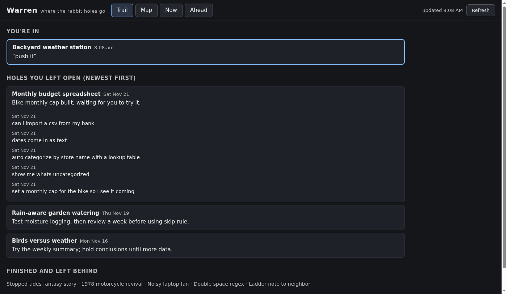
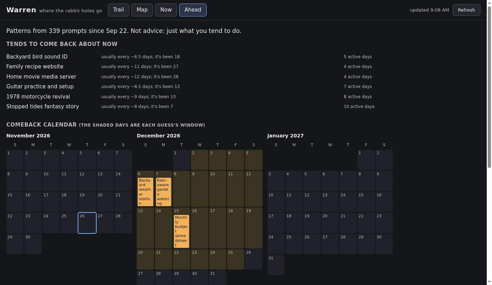

# Warren

**Where the rabbit holes go.** A private map of your train of thought, built from the prompts you type to [Claude Code](https://claude.com/claude-code).

If your mind goes down every rabbit hole along the way, Warren shows you the whole network: what you were doing, what you jumped to, which holes you left open, and which ideas keep coming back. Nobody has to label anything. Claude reads your prompts and names the threads itself.

> "For it shows things that were, and things that are, and things that yet may be. But which it is that he sees, even the wisest cannot always tell."
>
> Galadriel, on her Mirror, in J.R.R. Tolkien's *The Fellowship of the Ring*

Warren's Map and Trail are the things that were, Now is the things that are, and Ahead is the things that yet may be. Like the Mirror, it can't always tell which is which, so it keeps score of its own forecasts.



## What you get

Four tabs, in one page that runs on your own computer:

| Tab | What it shows |
| --- | --- |
| **Trail** | The thread you're in, then the holes you left open, newest first, each with a line on where it stood. For finding your way back after a tangent. |
| **Map** | Every prompt, sorted into threads, by month (newest or oldest first) or as a tree of what branched off what, plus a timeline. Sort threads biggest first or latest first; drag the panel edges to resize. Click anything to read it. |
| **Now** | The last week against your usual: where your time went, what's gone quiet, how much you're jumping around. |
| **Ahead** | Threads that tend to come back about now, a calendar of when the others are due, and the next four weeks by area. Patterns, not advice. It saves a forecast each day and keeps score of how many came true. |



The screenshots are from the built-in demo: a made-up person named Sam, who is building a weather station, writing a novel, and restoring a motorcycle.

## Install

You need Python 3.8 or newer and Claude Code (Warren uses its `claude` command).

```
pipx install git+https://github.com/ronniebnorth/warren
```

(or `pip install --user git+https://github.com/ronniebnorth/warren`)

Then:

```
warren demo     # try it on Sam's made-up history first; nothing of yours is read
warren          # open your own
```

Leave it open in its own window: it updates itself within about 3 minutes when you've typed something new (only new prompts cost a Claude request). `warren autostart` has it start with your computer, so the window is always ready.

The first time on your own history, Claude reads all your past prompts in batches, which can take several minutes. After that, only new prompts are read, so it opens in seconds.

## Commands

```
warren              open Warren in your browser (starts it if needed)
warren stop         stop it
warren where [DAYS] the trail back, in the terminal (last 3 days)
warren here [DAYS]  this week against your usual
warren next         comebacks due, the comeback calendar, the score
warren map          just the map, as a page
warren schedule     save a forecast once a day by itself (asks before adding a crontab line)
warren autostart    start Warren when the computer starts (asks before adding a crontab line)
warren demo         the made-up demo
```

## Privacy

- **Your history stays on your computer.** Warren reads the conversations Claude Code already saves (`~/.claude/projects`) and keeps its own files in `~/.local/share/warren`.
- **The page is local.** It listens on 127.0.0.1, so only your computer can open it. Nothing is uploaded or published.
- **The only thing sent anywhere** is each new prompt, once, to Claude through your own `claude` command, so it can name the threads. That's the same service you typed the prompt into in the first place. It runs on your plan; there's no separate key or account.

## Cost

Naming takes about one short Claude request per 70 new prompts, plus one a day for the forecast if you turn on `warren schedule`. It uses your Claude plan's normal usage.

## Settings

Environment variables, all optional:

| Variable | What it does | Default |
| --- | --- | --- |
| `WARREN_HOME` | where Warren keeps its files | `~/.local/share/warren` |
| `WARREN_CLAUDE_DIR` | where Claude Code keeps conversations | `~/.claude/projects` |
| `WARREN_NOTES` | a folder of older sessions you saved as notes by copying the terminal (each prompt starts with `❯`); dates from these are approximate | none |
| `WARREN_PORT` | the page's port | `8530` |
| `WARREN_MODEL` | the Claude model used for naming | `sonnet` |

## How it works

1. It reads only what you typed (not Claude's replies, not tool output) from each saved conversation.
2. New prompts go to Claude in batches with the threads so far. Claude puts each prompt in a thread, starts new ones with a short name, and says which thread each grew out of. Answers are saved, so each prompt is read once and names stay put.
3. From that: the trail (what you left, and whether it's still open, which Claude judges from the end of each thread), your usual week, how often each thread comes back, and where you tend to go next.

The forecasts are honest about their limits: they see rhythms in your habits, and can't see the new ideas that come out of nowhere, which are usually the best ones.

## License

MIT. Made by Ronnie North.
